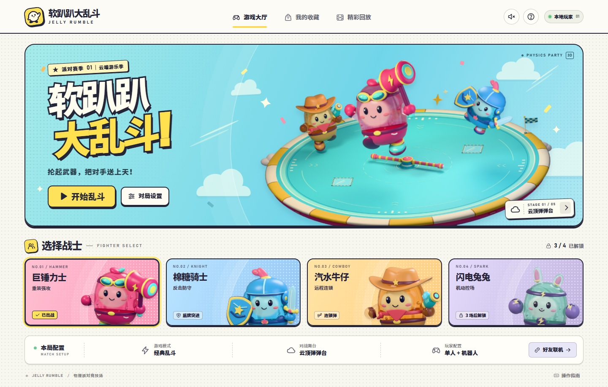
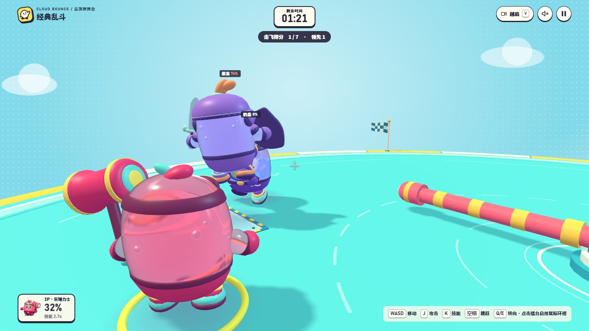
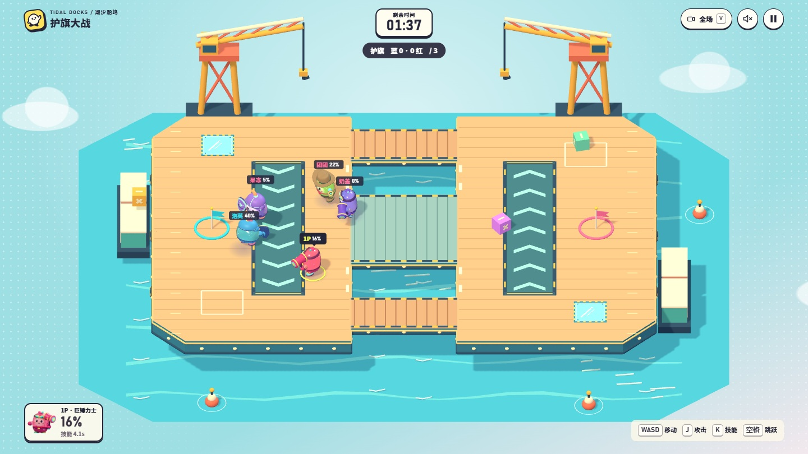
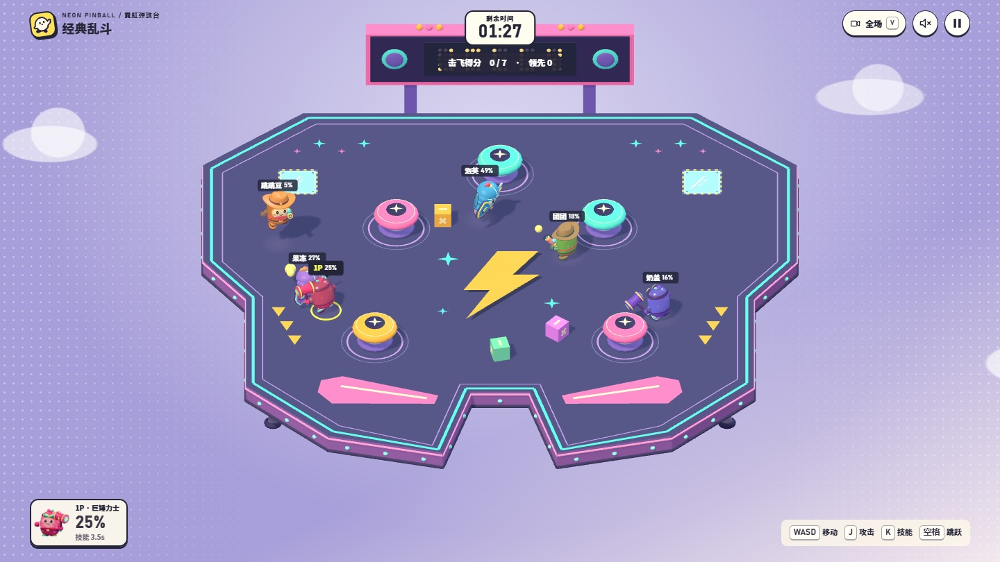

**越打越飞，软到失控。**

一群 Q 弹果冻，一座物理游乐场。抡起武器，和朋友一起制造混乱。

**[▶ 在线开玩](https://ranko-sama.github.io/ruanpapa/)**　·　**[下载版本](https://github.com/Ranko-sama/ruanpapa/releases/latest)**　·　**[游玩指南](./docs/PLAYING.md)**

5 张舞台 · 6 种模式 · 单人 / 同屏双人 / 双人联机 · 电脑与手机浏览器

 

## 软乎乎的身体，硬碰硬的快乐

- **每一锤，都让下一次飞得更远。** 没有血条，受击会积累击飞值。把对手送出擂台得分，掉下去也能自动复活，回来接着闹。
- **看得见的水果啫喱。** 半透明身体会折射背后的场景，跑动、跳跃和挨打时跟着压扁、拉伸、回弹。
- **武器打人，也搅乱场面。** 巨锤掀起地动波，骑士举盾突进，牛仔发射连锁弹；解锁闪电兔兔后，还能先吸拢物体，再用电磁脉冲震开。

当前浏览器版实机截图 · 默认越肩视角，按 V 切换正后方与全场视角

## 换一座舞台，换一种飞法

<table>
  <tr>
    <td width="50%"></td>
    <td width="50%"></td>
  </tr>
  <tr>
    <td><strong>潮汐船坞</strong> 三桥连双岸，绕后夺旗，别让传送带把你运进水里。</td>
    <td><strong>霓虹弹珠台</strong> 撞上弹簧柱就会改变飞行方向，小心台面前端的落口。</td>
  </tr>
</table>

还有充气擂台 **云顶弹弹台**、滑溜溜的 **汽水工厂** 和低重力的 **轨道乐园**。易碎玻璃、旋转软杆、失重与侧风，让场地也加入乱斗。

想各打各的，就选 **经典乱斗**；想一起过关，就挑战 **合作闯关**。也可以组队玩 **护旗大战、区域争夺、推车派对**，或抢走王冠，当一回 **软糖国王**。

## 拉上朋友，马上开局

打开 **[在线版](https://ranko-sama.github.io/ruanpapa/)**，选好战士、地图和模式，点击「开始乱斗」。单人局由机器人补足席位；「对局设置」里可以启用同屏双人。两台设备一起玩时，打开「好友联机」，通过邀请链接与回执码配对，具体步骤见[游玩指南](./docs/PLAYING.md#两台设备一起玩)。

| 动作 | 键鼠操作 |
| --- | --- |
| 移动 / 跳跃 | `W A S D` / `空格` |
| 攻击 / 技能 | `J` 或鼠标左键 / `K` 或鼠标右键 |
| 转动镜头 / 切换视角 | 鼠标或 `Q E` / `V` |
| 暂停 | `Esc` |

手机上使用屏幕摇杆和动作按钮。对局结束后会自动播放精彩片段，解锁的皮肤、配饰、表情和成就保存在当前浏览器。

## 来源与署名

本浏览器项目的玩法设定完全依据 Steam 游戏《软趴趴大乱斗》的商店简介制作。原作由 **蒼浪子** 开发并发行。[前往原作 Steam 商店页](https://store.steampowered.com/app/2800560/%E8%BD%AF%E8%B6%B4%E8%B6%B4%E5%A4%A7%E4%B9%B1%E6%96%97/?l=schinese)

本项目的代码、文档和自制素材以 **[Apache License 2.0](./LICENSE)** 开源。原作名称、商标和商店文案的相关权利由原权利人保留。随附的 Three.js 按 [MIT 许可证](./assets/THREE-LICENSE.txt)分发，详见 [NOTICE](./NOTICE)。

  <a href="./docs/PLAYING.md">游玩指南</a> · <a href="./docs/DEVELOPMENT.md">开发文档</a> · <a href="https://github.com/Ranko-sama/ruanpapa/releases">版本记录</a>

