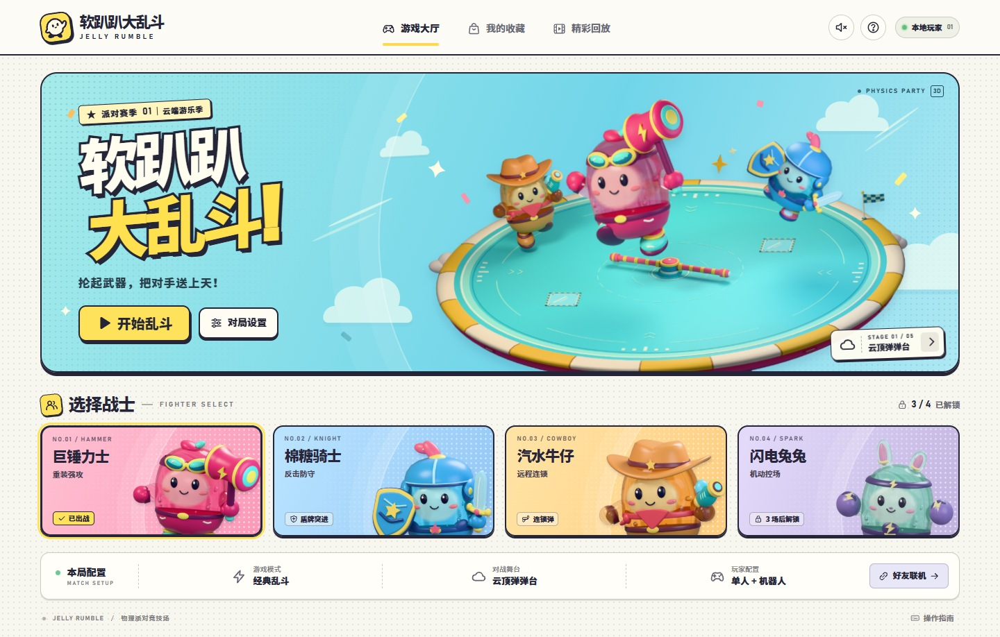

浏览器版首个 Release。打开网页，选个软乎乎的战士，开始一场越打越飞的物理派对。

**[▶ 在线开玩](https://ranko-sama.github.io/ruanpapa/)** · [游玩指南](https://github.com/Ranko-sama/ruanpapa/blob/v1.0.0/docs/PLAYING.md)

## 这一版可以玩什么

- **四位战士**：巨锤力士、棉糖骑士、汽水牛仔，以及可解锁的闪电兔兔；半透明水果啫喱身体会形变、回弹并折射背景。
- **五座舞台**：云顶弹弹台、汽水工厂、轨道乐园、潮汐船坞、霓虹弹珠台，包含旋转软杆、易碎玻璃、传送带和弹簧柱。
- **六种模式**：经典乱斗、合作闯关、护旗大战、区域争夺、推车派对和软糖国王。
- **一起开玩**：单人搭配机器人、同屏双人，或通过邀请链接与回执码完成双人 WebRTC 联机。键鼠与触屏均可操作。
- **三种视角**：默认越肩，按 `V` 切换居中正后方与全场视角。包含精彩回放、皮肤、配饰、表情与成就。

## 下载

- `ruanpapa-v1.0.0-web.zip`：完整静态网页游戏，解压后可部署到 GitHub Pages 或其他静态 HTTP 服务器，无需构建。
- `SHA256SUMS.txt`：上述压缩包的 SHA-256 校验值。
- GitHub 自动提供的 Source code 压缩包包含完整公开源码、文档与测试。

最快的游玩方式是直接打开在线版。联机需要网络支持 WebRTC 直连，当前版本未配置 TURN 中继服务。

## 开源与来源

本项目的代码、文档和自制素材以 [Apache License 2.0](https://github.com/Ranko-sama/ruanpapa/blob/v1.0.0/LICENSE) 开源；Three.js 保留 MIT 许可证。

本浏览器项目的玩法设定完全依据 Steam 游戏《软趴趴大乱斗》的商店简介制作，原作由 **蒼浪子** 开发并发行。[原作 Steam 商店页](https://store.steampowered.com/app/2800560/%E8%BD%AF%E8%B6%B4%E8%B6%B4%E5%A4%A7%E4%B9%B1%E6%96%97/?l=schinese)
